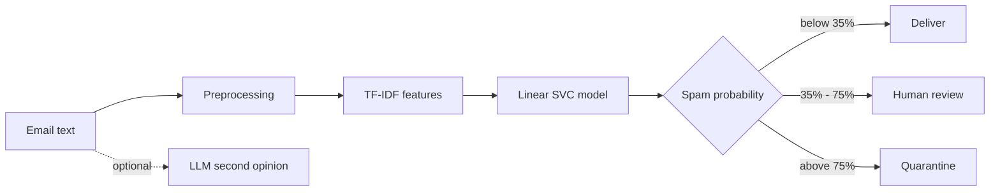

# Winnow — AI Email Classification System

Winnow is a web application that uses artificial intelligence to classify emails as **Spam** or
**Legitimate (Ham)**. It combines a machine-learning model trained on over 30,000 real emails
with an optional large language model (LLM) that explains its decision in plain English.

The name comes from *winnowing* — the old farming process of separating grain from chaff.
Winnow does the same for email.

**Result:** the trained model achieves **99.21% accuracy** on 6,093 emails it never saw during training.

---

## Table of Contents

1. [Project Overview](#1-project-overview)
2. [Features](#2-features)
3. [Technology Stack](#3-technology-stack)
4. [Dataset](#4-dataset)
5. [How the System Works](#5-how-the-system-works)
6. [Model Results](#6-model-results)
7. [Installation](#7-installation)
8. [How to Use](#8-how-to-use)
9. [Project Structure](#9-project-structure)
10. [Testing](#10-testing)
11. [Deployment](#11-deployment)
12. [Limitations](#12-limitations)
13. [Future Improvements](#13-future-improvements)
14. [License](#14-license)

---

## 1. Project Overview

Spam and phishing emails waste time and put users at risk. Winnow automatically reads an email,
predicts whether it is spam, and recommends one of three actions:

| Spam probability | Action |
|---|---|
| Below 35% | **Deliver** to the inbox |
| 35% – 75% | Send for **human review** |
| Above 75% | **Quarantine** as spam |

The middle "review" band exists because wrongly blocking a genuine email is worse than letting
one spam message through. Uncertain emails go to a person instead of being decided automatically.

---

## 2. Features

| Requirement | How Winnow meets it |
|---|---|
| **AI Model Integration** | A trained Linear SVC classifier, plus an optional LLM (Groq or Anthropic Claude) for a second opinion |
| **Data Preprocessing** | Cleans email text: removes HTML, normalises characters, and replaces URLs, email addresses, money amounts, phone numbers and numbers with tokens |
| **Model Training** | Trains and compares three algorithms using 5-fold cross-validation and automatically selects the best |
| **API-Based AI** | Sends the email to an LLM API and receives a structured JSON answer with reasoning |
| **User Authentication** | Sign-up and login with securely hashed passwords, admin and analyst roles, and account lockout after 5 failed attempts |
| **Interactive Dashboard** | Charts of classification activity and an explorer for the training dataset |
| **Prediction & Decision Output** | Shows the verdict, spam probability, confidence, recommended action, and the words that influenced the decision |
| **Performance Evaluation** | Accuracy, precision, recall, F1, ROC AUC, confusion matrix, ROC and precision-recall curves, and an interactive threshold tool |
| **Error Handling** | Clear error messages, input validation, safe fallbacks if the dataset or AI service is unavailable |
| **Professional Documentation** | This README, code comments, and an automated test suite |
| **Deployment** | Ready for Streamlit Community Cloud, plus a lightweight demo for Vercel |

---

## 3. Technology Stack

| Area | Tools |
|---|---|
| Language | Python 3.10+ |
| Web interface | Streamlit |
| Machine learning | scikit-learn (TF-IDF, Linear SVC, Logistic Regression, Naive Bayes) |
| Data handling | pandas, NumPy |
| Charts | Altair |
| AI / LLM APIs | Groq (`openai/gpt-oss-120b`), Anthropic Claude (optional) |
| Database | SQLite (users and prediction history) |
| Security | PBKDF2-HMAC-SHA256 password hashing |
| Testing | Python `unittest`, Streamlit `AppTest` |

---

## 4. Dataset

Winnow is trained on the **[Enron-Spam dataset](https://github.com/MWiechmann/enron_spam_data)**,
which contains real emails from the Enron company together with real spam messages.

| Detail | Value |
|---|---|
| Total emails | 33,716 |
| After removing duplicates and empty rows | 30,461 |
| Spam / Legitimate | 47.8% / 52.2% |
| Training set | 24,368 emails (80%) |
| Test set | 6,093 emails (20%) |

The dataset downloads automatically the first time you train the model.

---

## 5. How the System Works



**Step 1 — Preprocessing.** The email is cleaned. For example, `http://win-prize.com` becomes
`urltoken` and `$5,000` becomes `moneytoken`. This helps the model learn general patterns
instead of memorising specific links or amounts.

**Step 2 — Feature extraction.** The cleaned text is converted into numbers using **TF-IDF**,
which measures how important each word (and pair of words) is. The model uses 50,000 features.

**Step 3 — Classification.** Three models were trained and compared:

- Logistic Regression
- Linear Support Vector Classifier (Linear SVC)
- Multinomial Naive Bayes

**Linear SVC** scored highest in cross-validation and was selected.

**Step 4 — Decision.** The spam probability is turned into an action (deliver, review, or
quarantine), and the words that most affected the score are displayed.

**Step 5 — AI second opinion (optional).** The email can also be sent to an LLM, which returns
its own verdict and a written explanation.

---

## 6. Model Results

All results are measured on the **6,093 test emails** that were not used for training.

### Final model performance

| Metric | Score |
|---|---|
| Accuracy | **99.21%** |
| Precision | **98.87%** |
| Recall | **99.48%** |
| F1 Score | **0.9918** |
| ROC AUC | **0.9993** |

### Confusion matrix

|  | Predicted Legitimate | Predicted Spam |
|---|---|---|
| **Actual Legitimate** | 3,149 | 33 |
| **Actual Spam** | 15 | 2,896 |

Only 48 of 6,093 emails were classified incorrectly.

### Comparison of models

| Model | Cross-validation F1 | Test Accuracy |
|---|---|---|
| **Linear SVC (selected)** | **0.9907** | **99.16%** |
| Logistic Regression | 0.9885 | 99.06% |
| Naive Bayes | 0.9873 | 98.77% |

The difference between training and test F1 score is only **0.0067**, which shows the model is
not overfitting.

---

## 7. Installation

### Requirements

- Python 3.10 or newer
- Internet connection (to download the dataset and use the optional AI service)

### Steps

**1. Download the project**

```bash
git clone https://github.com/<your-username>/ai-email-classifier.git
cd ai-email-classifier
```

**2. Create a virtual environment (recommended)**

```bash
python -m venv .venv
.venv\Scripts\activate          # Windows
source .venv/bin/activate       # macOS / Linux
```

**3. Install the required packages**

```bash
pip install -r requirements.txt
```

**4. (Optional) Add your API key**

Copy `.streamlit/secrets.toml.example` to `.streamlit/secrets.toml` and add your key:

```toml
GROQ_API_KEY = "your-groq-api-key"
ADMIN_USERNAME = "admin"
ADMIN_PASSWORD = "choose-a-strong-password"
```

The app works without an API key — only the "AI second opinion" feature needs it.
Never upload `secrets.toml` to GitHub; it is already excluded by `.gitignore`.

**5. Train the model** (only needed if `models/spam_classifier.joblib` is missing — takes about 3 minutes)

```bash
python -m src.train
```

**6. Run the application**

```bash
python -m streamlit run app.py
```

On Windows you can simply double-click **`run_app.bat`**.

Then open **http://localhost:8501** in your browser.

---

## 8. How to Use

**Default login:** username `admin`, password `ChangeMe!123` (change it after your first login
from the Admin page).

| Page | What you can do |
|---|---|
| **Home** | See system status and the model's key results |
| **Classify** | Paste an email (or click a sample), get the verdict, see which words influenced it, and optionally ask the AI for a second opinion |
| **Batch** | Upload a CSV file of emails, classify all of them at once, and download the results |
| **Dashboard** | View charts of past classifications and explore the training dataset |
| **Performance** | Examine the confusion matrix, ROC curve, threshold tool, model comparison, and misclassified emails |
| **Admin** | Manage users, retrain the model, and change your password (admins only) |

---

## 9. Project Structure

```
ai-email-classifier/
├── app.py                  # Main application and page navigation
├── run_app.bat             # One-click launcher for Windows
├── requirements.txt        # Python packages
├── src/
│   ├── preprocessing.py    # Text cleaning
│   ├── dataset.py          # Dataset download and validation
│   ├── train.py            # Model training and selection
│   ├── evaluation.py       # Performance metrics
│   ├── predictor.py        # Making predictions
│   ├── llm_classifier.py   # AI (LLM) integration
│   ├── auth.py             # Login and user accounts
│   ├── history.py          # Saving prediction history
│   ├── charts.py           # Chart creation
│   ├── config.py           # Settings
│   ├── exceptions.py       # Error types
│   ├── logger.py           # Logging
│   └── ui.py               # Shared interface helpers
├── views/                  # One file per page
├── tests/                  # Automated tests
├── models/                 # Trained model and metrics
├── data/                   # Dataset samples and databases
└── vercel-demo/            # Lightweight demo for Vercel
```

---

## 10. Testing

Run all tests with:

```bash
python -m unittest discover -s tests -v
```

The project includes **95 automated tests** covering text cleaning, dataset validation, model
accuracy, login security, the AI integration, and every page of the web interface.

---

## 11. Deployment

### Streamlit Community Cloud (recommended)

1. Upload the project to a GitHub repository.
2. Go to [share.streamlit.io](https://share.streamlit.io) and click **New app**.
3. Select your repository and set the main file to `app.py`.
4. Open **Advanced settings → Secrets** and paste the contents of your `secrets.toml`.
5. Click **Deploy**.

### Vercel (demo version)

Vercel cannot run the full Streamlit app, because Streamlit needs a server that stays running.
The `vercel-demo/` folder contains a simpler one-page version (paste an email, get a verdict).

1. Go to [vercel.com/new](https://vercel.com/new) and import the GitHub repository.
2. Set **Root Directory** to `vercel-demo`.
3. Click **Deploy**.

See [`vercel-demo/README.md`](vercel-demo/README.md) for details.

---

## 12. Limitations

- **Old dataset.** The emails are from 1999–2005. Modern spam, including AI-written phishing,
  may be harder for the model to detect.
- **Company-specific words.** The legitimate emails all come from Enron, so words like "Enron",
  "gas" and "Houston" are treated as signs of a genuine email. The model should be retrained on
  your own emails before real use.
- **Temporary storage online.** On Streamlit Community Cloud, user accounts and history are
  reset when the app restarts.
- **Privacy.** When the AI second opinion is used, the email is sent to an external service.
  This feature is off by default.

---

## 13. Future Improvements

- Retrain on a more recent and varied email dataset
- Add a transformer model such as BERT for comparison
- Store users and history in a permanent cloud database
- Connect directly to Gmail or Outlook to scan an inbox
- Support more categories (phishing, promotions, social, work)

---

## 14. License

This project is released under the **MIT License**. The Enron-Spam dataset is provided by its
original maintainers under their own terms.
